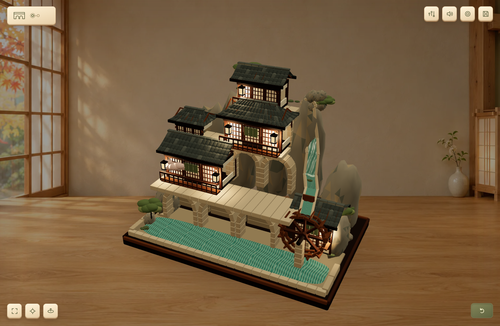

# 3D 搭建工作台 · Assembly Workshop

[立即搭建](https://dhcfe.github.io/assembly-workshop/) · [自部署](#self-host) · [场景格式](docs/scene-format.md) · [English](docs/english.md)

在浏览器里亲手装配真实 3D 构件。玩家从零件盒拿起木石，拖入轮廓，再推、拉、转动或沿路径加工。同一个建筑可以用不同操作密度搭完。木作水磨山居支持台边拼水轮、整体入轴、开闸和点灯。



## 怎么玩

桌面浏览器全屏配鼠标最容易上手。打开「木作水磨山居」，选择 **Easy** 或 **Medium**，从盒中拖出当前构件。零件进入轮廓后，沿构件上的提示完成加工。拖空白处绕模型看，滚轮缩放。右下角可看成品，左下角可重置镜头或进入全屏。耳机能听清轻重、落座和连击的声音。

Easy 将相邻工序组合，Medium 减少重复动作，Hard 按原始工序逐件搭。各档共用同一套成品几何。可在右上角切换难度，已搭进度沿用。支持触屏拖拽和键盘操作。键盘可用 Tab 选零件、Enter 放入、方向键加工、End 完成当前动作。F 聚焦，M 静音。

浏览器自动保存进度。「搭建存档」可下载或导入 `.assembly.json`。点击录制后实际操作，结束时下载 MP4 或 WebM。浏览器须支持 WebGL 2。低配置设备可在场景地址加 `?quality=low`。使用 Blender 后台的服务可另外导出可编辑 `.blend`。

<a id="self-host"></a>
## 自部署

需要 Node.js 20+ 和 Python 3.10+。安装 Blender 5.2 LTS 可启用照片生成与 Blender 导出。运行时从 `BLENDER_BIN`、系统路径或 macOS 的标准安装位置寻找 Blender。Windows 可用 PowerShell 和 `py -3` 替代下面的 `python3`。

```sh
npm ci
npm run build
python3 runtime/server.py
```

打开 `http://127.0.0.1:8765/`。内置场景可以直接搭建。`npm run build` 同时产出 `dist/`，可放进任意静态站或 GitHub Pages。静态站支持试玩、续玩、存档文件和录像下载。

### 用照片开工

配置一个视觉模型提供方，再启动服务。

| 提供方 | 启动前的配置 |
| --- | --- |
| Codex CLI | 安装并登录 Codex，启动时加 `--provider codex` |
| Claude Code | 安装并登录 Claude Code，启动时加 `--provider claude-code`。授权它读取任务目录里的图片 |
| 兼容 API | 设置 `WORKSHOP_AI_BASE_URL`、`WORKSHOP_AI_MODEL` 和服务要求的 `WORKSHOP_AI_API_KEY`，启动时加 `--provider openai-compatible` |

兼容 API 接受图像输入和 Chat Completions JSON 输出。`WORKSHOP_AI_BASE_URL` 填包含 API 版本路径的基础地址。默认请求 JSON Schema。只支持 JSON 对象模式的服务可设 `WORKSHOP_AI_JSON_MODE=object`。具体模型应能理解图片。模型端凭据只留在运行服务的机器上。

打开「照片开工」，提交 12 MiB 以内的 JPEG、PNG 或 WebP。地台与主体并行准备。工作台在地台发布后打开，随后接收主体和屋面。当前自动配方使用受校验的建筑体块，适合快速做可玩的轻量建筑。复杂精品场景可导入精细制作的 Blender 工程。生成服务会把参考图送到所选模型提供方，项目素材和生成结果保存在服务的数据目录。

### 容器

将 `.env.example` 复制为 `.env`，按需填兼容 API 配置，再运行 `docker compose up --build`。默认 `WORKSHOP_PROVIDER=off`，可试玩和导出，填好生成服务后可上传照片。容器安装 Ubuntu 发行版提供的 Blender。容器中默认走兼容 API，本机登录过的 Codex 或 Claude Code 可使用上述原生启动方式。

### 团队部署

默认服务绑定本机。对外部署用 HTTPS 反向代理，将 `--origin` 设成实际访问地址，设置 `WORKSHOP_ACCESS_TOKEN`。将该口令交给团队成员，他们可以从「照片开工」页登录。部署以个人或共享工作室为单位，成员共用生成项目列表。每位玩家的搭建进度保存在各自浏览器。保持一个服务实例管理同一数据目录。通过 `--data-dir` 指定可持久化的位置。

## 用自己的模型

在一个目录里放 `.blend` 和 [施工配方](docs/scene-format.md)。每个可操作构件有稳定的名字和对应工序。准备和导入会由 Blender 编译网页资产。

```sh
python3 runtime/cli.py import /path/to/scene
```

打开命令返回的本地项目路径。静态试玩保存的进度也能用本地 Blender 导出。

```sh
python3 runtime/cli.py export examples/wood-village my-progress.assembly.json built.blend
```

Codex 可加载仓库里的插件。Claude Code、WorkBuddy 等宿主可使用 [`skills/workshop`](skills/workshop/SKILL.md) 中的说明和同一组导入命令。宿主负责生成或打开项目，实时搭建运行在浏览器。

## 代码和素材在哪里

| 路径 | 内容 |
| --- | --- |
| `web/` | 工作台、3D 零件盒、操作、动画和浏览器存档 |
| `site/` | 入口页、照片开工交互、实机预览图 |
| `runtime/` | 场景准备、照片生成、分区发布、保存与导出服务 |
| `examples/` | 两个完整场景的 `.blend`、配方、索引和网页模型 |
| `skills/workshop/` | AI 宿主可复用的项目工作流 |
| `tests/` | 配方与存档回归测试 |

技术说明见 [架构与验收](docs/architecture.md)。代码与本仓库示例以 **GPL-3.0-or-later** 发布。第三方通知与素材来源见 [授权说明](docs/assets.md)。
